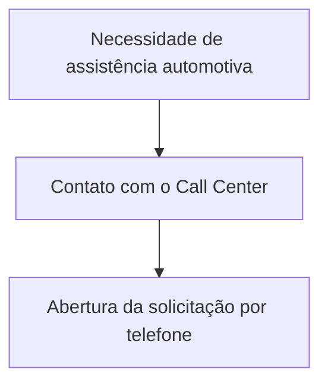
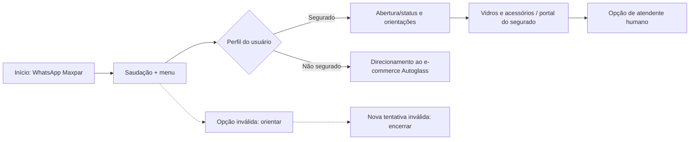

# Canais digitais

**Estudo de caso de Product Owner e Análise de Negócios — do desafio de negócio à prova de conceito (POC)**

**Competências:** Product Discovery · Jornada do Usuário · AS IS / TO BE · Visão de Produto · MVP · Backlog · Histórias de Usuário · BDD · Indicadores · Prototipação · Miro.

> **Visão do projeto:** estruturar um canal digital para início autônomo de atendimentos de assistência automotiva, com foco em clareza da jornada e menor dependência do Call Center. O repositório apresenta o percurso de análise e a validação visual por POCs; **não afirma implantação em produção ou ganhos operacionais medidos**.

[**Acessar apresentação visual do case no GitHub Pages**](https://bertat2c.github.io/canais-digitais.html) · [**Explorar o quadro completo no Miro**](https://miro.com/app/board/uXjVNlaxnuE=/) · [**Assistir à POC 01**](https://youtu.be/u4LxF7WXEUY)

## Do estudo à POC — evolução do projeto

| Etapa | Pergunta de produto | Artefato do estudo |
| --- | --- | --- |
| **1. Desafio e objetivos** | Que problema estamos resolvendo e para quem? | Briefing de Product Owner e definição da oportunidade |
| **2. Discovery e diagnóstico** | Como o atendimento funciona hoje? | Pesquisa de referências, canais, dores, análise AS IS no Miro |
| **3. Missão, visão e MVP** | Qual experiência queremos entregar primeiro? | Canvas MVP e definição inicial da solução |
| **4. Jornada futura e regras** | Como será a navegação e o tratamento das exceções? | TO BE, fluxos e regras de atendimento |
| **5. Backlog e critérios de aceite** | Como traduzir a experiência em entregas? | Backlog, histórias e 10 cenários BDD documentados |
| **6. Prova de conceito** | Como demonstrar a jornada antes da implantação? | POC 01 com vídeo e POC 02 com sequência de telas no Miro |
| **7. Métricas e evolução** | Como validar valor para o negócio? | Indicadores propostos, hipóteses e próximos passos |

### 1. Desafio de negócio

O briefing do desafio de Product Owner apresenta a necessidade de uma ferramenta digital para **abertura autônoma de assistência automotiva**, incluindo **guincho, carro reserva e motorista amigo**, por segurados/beneficiários. Segundo o briefing, a abertura era realizada exclusivamente por chamadas ao **Call Center**, criando uma experiência pouco flexível e uma desvantagem competitiva.

**Objetivo descrito:** oferecer um canal de solicitação que melhore a experiência e a eficiência operacional. Para a apresentação, foram solicitados missão e visão do produto, MVP, backlog, critérios de sucesso, indicadores e, como diferencial, um protótipo básico.

### 2. Discovery e análise do cenário atual

O Discovery usou pesquisa desk para contextualizar o atendimento digital em seguros e formular hipóteses para o MVP de assistência automotiva.

| Evidência | Recorte e fonte |
| --- | --- |
| **WhatsApp (30%), telefone (30%), chat no site (20%) e app da empresa (12%)** | Primeiro canal escolhido para resolver um problema com uma empresa. Pesquisa de atendimento geral com 1.176 brasileiros de 16 anos ou mais que tinham smartphone. [Mobile Time e Opinion Box, março de 2024](https://www.mobiletime.com.br/noticias/20/05/2024/whatsapp-e-telefone-sao-os-canais-de-atendimento-preferidos-do-brasileiro/). |
| **36% dos clientes de seguro auto receberam atualizações de sinistro pelo app** | Uso observado na jornada de sinistro. [JD Power, EUA, 2025](https://www.jdpower.com/business/press-releases/2025-us-claims-digital-experience-study). |
| **Assistência 24h foi o serviço mais acionado no WhatsApp da Allianz (35%)** | Dado da seguradora. O WhatsApp também direcionava para chat ou telefone. [Sindseg, Brasil, julho de 2025](https://www.sindicatoseguradoras.com.br/2025/07/01/uso-dos-canais-digitais-cresce-mais-de-20-na-allianz-seguros/). |

#### Síntese do Discovery · 2024–2025

| Recorte | Evidência | Decisão para o MVP |
| --- | --- | --- |
| Brasil · atendimento ao consumidor · 2024 | WhatsApp e telefone foram a primeira escolha de 30% dos entrevistados cada. Chat no site teve 20% e app, 12%. | Testar WhatsApp como entrada e manter o telefone acessível para quem preferir atendimento por voz. |
| Brasil · Allianz Seguros · 2025 | Assistência 24h foi o serviço mais acionado no WhatsApp da seguradora (35%). O canal também direcionava para chat ou telefone. | Priorizar a solicitação de assistência e oferecer encaminhamento ao atendimento humano. |
| EUA · seguro auto · 2025 | No estudo da JD Power, 36% dos clientes de seguro auto receberam atualizações de sinistro pelo app. | Testar confirmação por protocolo e acompanhamento do pedido como hipótese para a jornada de assistência. |

Os percentuais têm bases e objetivos diferentes. Cada dado orienta uma hipótese de produto.

**Validação:** Medir a taxa de conclusão da abertura digital, os recontatos pelo mesmo pedido e as transferências para atendimento humano. Comparar os indicadores por canal no piloto.

**AS IS:** atendimento dependente de chamadas, jornadas distribuídas por WhatsApp, portal e atendimento humano, com necessidade de direcionamento mais claro e tratamento de opções inválidas. [Abrir Discovery no Miro](https://miro.com/app/board/uXjVNlaxnuE=/?moveToWidget=3458764581172626138).

#### Visão simplificada do AS IS

O briefing descreve a abertura de assistência (guincho, carro reserva e motorista amigo) por telefone. No Discovery, WhatsApp e portal também aparecem como pontos de contato da jornada mais ampla, com registros de interações sem resposta ou sem direcionamento e necessidade de informar o horário de atendimento. [Consultar o Discovery no Miro](https://miro.com/app/board/uXjVNlaxnuE=/?moveToWidget=3458764581172626138).

### 3. Direcionamento de produto — missão, visão e MVP

- **Missão proposta a partir do briefing:** facilitar o início da assistência automotiva por autosserviço, com orientações simples e acesso claro aos serviços disponíveis.
- **Visão proposta:** permitir que segurados e beneficiários solicitem ou iniciem atendimento por canal digital, com comunicação compreensível, alternativas de suporte e evolução incremental dos serviços.
- **Resultado esperado no Canvas:** possibilitar que segurados/beneficiários realizem a abertura de atendimento de assistência de maneira autônoma.
- **Público indicado:** pessoas com seguro automotivo e familiaridade com aplicativos e mensagens.
- **Jornada preliminar do Canvas:** acesso ao aplicativo/canal → entrada na base de clientes → identificação da seguradora → consulta aos dados da seguradora.
- **Escopo inicialmente explorado:** canal automatizado para consultar opções de assistência e orientar o atendimento. O estudo no Miro aprofunda menus, transbordo humano e direcionamentos.

**Premissas do Canvas:** há referência a **3 semanas**, equipe de **desenvolvedor/Product Owner** e plataforma **Zenvia (R$ 700,00)**. São informações de planejamento exibidas no artefato, **não investimento realizado, custo total comprovado ou compromisso de prazo**.

[Consultar Canvas MVP original no Miro](https://miro.com/app/board/uXjVNlaxnuE=/?moveToWidget=3458764581793445322).

### 4. Modelagem da jornada e da solução proposta

O trabalho passou pela análise de atendimento de segurados, beneficiários e não segurados. O **TO BE** incluiu saudação, escolhas de menu, mensagens de orientação, encaminhamento para portal/e-commerce, opção de atendente humano e regras para respostas inválidas.

A evolução explorada no backlog contempla **Assistência Dia e Noite**, **Seguradoras**, **Oficina** e **voltar ao menu**. Não significa que todas essas opções foram desenvolvidas ou implantadas.

- [Jornada documentada — 43 etapas e 36 ligações](./docs/FLUXO_MIRO_JORNADA_COMPLETA.md)
- [Estudo de backlog — 34 etapas e 24 ligações](./docs/FLUXO_MIRO_BACKLOG_COMPLETO.md)
- [Quadro original com fluxos e telas](https://miro.com/app/board/uXjVNlaxnuE=/)

### 5. Backlog, histórias de usuário e aceitação

Os artefatos registram cenários em formato **Dado / Quando / Então** para saudação, seleção de perfil, tratamento de respostas incorretas e direcionamento ao atendimento humano.

**Exemplo sintético, baseado nas regras documentadas:**

> **Dado** que o usuário tenha recebido o menu inicial, **quando** selecionar uma opção não reconhecida pela primeira vez, **então** o canal deve orientá-lo a informar uma opção válida. Em uma segunda entrada inválida, a jornada documentada prevê mensagem de orientação e encerramento.

Este exemplo resume o comportamento original; não substitui os **10 cenários completos**: [consultar requisitos e BDD](./docs/CENARIOS_E_REGRAS_ORIGINAIS.md).

### 6. POCs — demonstração da experiência

- **POC 01:** demonstração de jornada digital, com [vídeo](https://youtu.be/u4LxF7WXEUY) e [frame no Miro](https://miro.com/app/board/uXjVNlaxnuE=/?moveToWidget=3458764582022045353).
- **POC 02:** sequência de telas e interações proposta para o MVP, preservada no [quadro do Miro](https://miro.com/app/board/uXjVNlaxnuE=/?moveToWidget=3458764582024733080).

**Entrega demonstrável:** análise, definição da jornada, documentação de requisitos e protótipos de validação visual. A POC **não equivale a implantação real nem comprova redução de chamadas ao Call Center**.

### 7. Indicadores de sucesso propostos

| Indicador | O que acompanharia | Situação |
| --- | --- | --- |
| Cliques/acionamentos da automação | Interesse e utilização da jornada | Proposto no Canvas |
| Quantidade de depoimentos coletados | Feedback qualitativo dos usuários | Proposto no Canvas |
| Pesquisa NPS | Percepção de satisfação com a experiência | Proposto no Canvas |
| Taxa de início e conclusão de solicitações | Capacidade de concluir a jornada sem abandono | Sugestão de evolução analítica |
| Transferência para atendimento humano | Dependência operacional do Call Center | Sugestão de evolução analítica |

**Não há valores de resultados efetivos pós-implantação neste case.** As fontes representam material de desafio, desenho de solução e POCs; os indicadores acima são instrumentos para uma validação futura.

---

## Navegue pelo projeto

| Etapa | Conteúdo disponível |
| --- | --- |
| **1. Discovery** | [Análise dos canais e oportunidades de melhoria no Miro](https://miro.com/app/board/uXjVNlaxnuE=/?moveToWidget=3458764581172626138) |
| **2. Canvas MVP** | [Quadro visual de análise e referências](https://miro.com/app/board/uXjVNlaxnuE=/?moveToWidget=3458764581793445322) |
| **3. Jornada de atendimento** | [Fluxo completo no GitHub — 43 etapas e 36 ligações](./docs/FLUXO_MIRO_JORNADA_COMPLETA.md) · [Miro original](https://miro.com/app/board/uXjVNlaxnuE=/?moveToWidget=3458764581758623044) |
| **4. Requisitos / BDD** | [10 cenários de usuário e regras originais](./docs/CENARIOS_E_REGRAS_ORIGINAIS.md) |
| **5. Estudo de backlog** | [Fluxo completo no GitHub — 34 etapas e 24 ligações](./docs/FLUXO_MIRO_BACKLOG_COMPLETO.md) · [Miro original](https://miro.com/app/board/uXjVNlaxnuE=/?moveToWidget=3458764581755947826) |
| **6. POC 01** | [Frame no Miro](https://miro.com/app/board/uXjVNlaxnuE=/?moveToWidget=3458764582022045353) · [Vídeo demonstrativo](https://youtu.be/u4LxF7WXEUY) |
| **7. POC 02** | [Frame no Miro com a sequência de telas](https://miro.com/app/board/uXjVNlaxnuE=/?moveToWidget=3458764582024733080) |
| **Documentação completa** | [Contexto, jornada, backlog, comportamentos e evidências](./docs/CASE_MAXPAR_AUTOGLASS.md) |

## Objetivo de negócio

Analisar e estruturar uma jornada de atendimento via WhatsApp que **oriente o usuário ao canal adequado**, diferencie o atendimento para segurados e não segurados e reduza ambiguidades na navegação.

No quadro, o **WhatsApp da Maxpar Serviços** conduz o contato inicial e apresenta informações de assistência relacionadas ao seguro. O encaminhamento à **Autoglass** é documentado nos casos voltados a **compra de peças automotivas**, incluindo o direcionamento ao e-commerce.

## Canais digitais e jornada analisados

| Canal ou ponto de contato | Papel identificado no quadro | Oportunidade documentada |
| --- | --- | --- |
| **WhatsApp da Maxpar** | Primeiro contato com segurados ou não segurados, apresentação de menu e mensagens de orientação | Tornar as opções claras, tratar respostas inválidas e oferecer transbordo para atendimento humano |
| **Portal do Segurado (Maxpar)** | Consulta e abertura de atendimento, com orientação para selecionar o card **Segurado & Corretor** e a seguradora | Facilitar o direcionamento correto, evitando navegação confusa |
| **E-commerce Autoglass** | Canal indicado para quem busca compra de peças automotivas | Informar o destino adequado aos não segurados e na mensagem de encerramento |
| **Canais complementares** | Atendimento humano, assistência 24 horas e Linktree relacionados à jornada | Orientar sobre horários, meios de contato e alternativas para cada necessidade |

**AS IS — pontos observados no Discovery:** registros de interações sem resposta ou sem direcionamento, necessidade de informação de horário de atendimento e existência de diferentes pontos de contato. São observações do quadro, não medições de desempenho.

**Evolução estudada / TO BE:** jornada com menu orientado ao perfil, mensagens compreensíveis, tratamento de opções inválidas, direcionamento para atendimento humano e estudo de menu de serviços (**Assistência Dia e Noite, Seguradoras, Oficina e voltar**).

**POCs:** o quadro inclui protótipos e demonstração do fluxo. A existência de um MVP ou POC **não significa, por si só, implantação em produção**.

## Jornada proposta (TO BE) documentada no Miro

**Importante:** essa é uma **visão executiva simplificada**, não uma alteração do fluxograma original. Consulte o [fluxo completo no Miro](https://miro.com/app/board/uXjVNlaxnuE=/?moveToWidget=3458764581758623044), que contém todos os caminhos, decisões, mensagens e conexões.

## Escopo funcional e oportunidades observadas

- **Discovery:** análise dos canais digitais, possíveis falhas de direcionamento, horários e continuidade do atendimento.
- **Jornada do usuário:** diferenciação entre segurado e não segurado, instruções do WhatsApp e orientação ao portal e e-commerce.
- **Regras de negócio:** até duas tentativas para opção inválida e encerramento com mensagem após a segunda falha.
- **Transbordo:** disponibilização da opção de atendimento humano, conforme a jornada modelada.
- **Backlog / MVP:** estudo de opções de Assistência Dia e Noite, Seguradoras, Oficina e retorno ao menu, com detalhamento de algumas ramificações no Miro.
- **POCs:** referências de telas e demonstração vinculadas ao quadro original.

O quadro contém **cenários denominados “Sou segurado” e “Sou cliente” em documentos diferentes**. Mantive ambos como registrados na fonte, em vez de presumir que são equivalentes.

## Vídeo e evidências do projeto

**POC 01 — demonstração mantida:**

https://youtu.be/u4LxF7WXEUY

**Quadro completo, com todos os fluxos, telas, prints, canvas e POCs — endereço oficial:**  
https://miro.com/app/board/uXjVNlaxnuE=/

## Meu papel e competências demonstradas

**Business Analysis | Discovery | Jornada do Usuário | AS IS / TO BE | Mapeamento de Processos | Requisitos Funcionais | BDD | Critérios de Aceite | Backlog | MVP | Stakeholder Management | Miro | Canais Digitais | Chatbots | WhatsApp**

Esse case demonstra como a **análise da operação, o mapeamento visual e a escrita de regras e cenários** ajudam a estruturar decisões de produto e melhorias na experiência de atendimento.

## Documentação complementar

- [Case detalhado Maxpar / Autoglass](./docs/CASE_MAXPAR_AUTOGLASS.md)
- [Jornada completa extraída do Miro — etapas, conexões e mensagens](./docs/FLUXO_MIRO_JORNADA_COMPLETA.md)
- [Estudo de backlog completo extraído do Miro — etapas, conexões e mensagens](./docs/FLUXO_MIRO_BACKLOG_COMPLETO.md)
- [Cenários e regras transcritos do Miro sem mudar seu conteúdo](./docs/CENARIOS_E_REGRAS_ORIGINAIS.md)
- [README original, preservado integralmente](./DOCUMENTACAO_ORIGINAL.md)

> **Escopo:** os fluxos textuais permitem consultar a jornada e o backlog também pelo GitHub; o quadro original no Miro permanece como referência para a navegação visual, telas e POCs. O estudo não apresenta indicadores comprovados de implantação.
