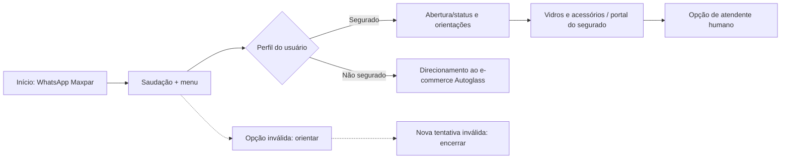

# Case de Canais Digitais | WhatsApp Maxpar / Autoglass

**Análise de Negócios · Discovery · Mapeamento de Processos · Jornada do Usuário · MVP · Backlog · BDD**

Projeto de estudo e evolução de atendimento digital ligado a **seguros auto**, serviços ao segurado/beneficiário e direcionamento ao **e-commerce da Autoglass**, conforme o [quadro original do Miro](https://miro.com/app/board/uXjVNlaxnuE=/).

O case reúne investigação da jornada existente, desenho de opções de atendimento no WhatsApp da Maxpar, cenários de resposta, regras de negócio, estudo de futuras funcionalidades e provas de conceito (POCs).

> **Os fluxos, as tarefas, imagens e os dados originais não foram alterados.** A fonte visual e funcional continua sendo o [quadro do Miro](https://miro.com/app/board/uXjVNlaxnuE=/). Esta página é uma organização do case para portfólio, não uma afirmação de que todos os fluxos foram implantados.

## Navegue pelo projeto

| Etapa | Conteúdo disponível |
| --- | --- |
| **1. Discovery** | [Análise dos canais e oportunidades de melhoria no Miro](https://miro.com/app/board/uXjVNlaxnuE=/?moveToWidget=3458764581172626138) |
| **2. Canvas MVP** | [Quadro visual de análise e referências](https://miro.com/app/board/uXjVNlaxnuE=/?moveToWidget=3458764581793445322) |
| **3. Jornada de atendimento** | [Fluxograma original de segurado e não segurado](https://miro.com/app/board/uXjVNlaxnuE=/?moveToWidget=3458764581758623044) |
| **4. Requisitos / BDD** | [10 cenários de usuário e regras originais](./docs/CENARIOS_E_REGRAS_ORIGINAIS.md) |
| **5. Estudo de backlog** | [Fluxograma de opções do MVP no Miro](https://miro.com/app/board/uXjVNlaxnuE=/?moveToWidget=3458764581755947826) |
| **6. POC 01** | [Frame no Miro](https://miro.com/app/board/uXjVNlaxnuE=/?moveToWidget=3458764582022045353) · [Vídeo demonstrativo](https://youtu.be/u4LxF7WXEUY) |
| **7. POC 02** | [Frame no Miro com a sequência de telas](https://miro.com/app/board/uXjVNlaxnuE=/?moveToWidget=3458764582024733080) |
| **Documentação completa** | [Contexto, jornada, backlog, comportamentos e evidências](./docs/CASE_MAXPAR_AUTOGLASS.md) |

## Objetivo de negócio

Analisar e estruturar uma jornada de atendimento via WhatsApp que **oriente o usuário ao canal adequado**, diferencie o atendimento para segurados e não segurados e reduza ambiguidades na navegação.

No quadro, o **WhatsApp da Maxpar Serviços** conduz o contato inicial e apresenta informações de assistência relacionadas ao seguro. O encaminhamento à **Autoglass** é documentado nos casos voltados a **compra de peças automotivas**, incluindo o direcionamento ao e-commerce.

## Jornada documentada no Miro

**Importante:** essa é uma **visão executiva simplificada**, não uma alteração do fluxograma original. Consulte o [fluxo completo no Miro](https://miro.com/app/board/uXjVNlaxnuE=/?moveToWidget=3458764581758623044), que contém todos os caminhos, decisões, mensagens e conexões.

### Mapeamento AS IS já publicado

O material original que já estava neste repositório permanece disponível:

## Escopo funcional e oportunidades observadas

- **Discovery:** análise dos canais digitais, possíveis falhas de direcionamento, horários e continuidade do atendimento.
- **Jornada do usuário:** diferenciação entre segurado e não segurado, instruções do WhatsApp e orientação ao portal e e-commerce.
- **Regras de negócio:** até duas tentativas para opção inválida e encerramento com mensagem após a segunda falha.
- **Transbordo:** disponibilização da opção de atendimento humano, conforme a jornada modelada.
- **Backlog / MVP:** estudo de opções de Assistência Dia e Noite, Seguradoras, Oficina e retorno ao menu, com detalhamento de algumas ramificações no Miro.
- **POCs:** referências de telas e demonstração vinculadas ao quadro original.

O quadro contém **cenários denominados “Sou segurado” e “Sou cliente” em documentos diferentes**. Mantive ambos como registrados na fonte, em vez de presumir que são equivalentes.

## Vídeo e evidências do projeto

**POC 01 — demonstração mantida:**

https://youtu.be/u4LxF7WXEUY

**Quadro completo, com todos os fluxos, telas, prints, canvas e POCs:**  
https://miro.com/app/board/uXjVNlaxnuE=/?share_link_id=919581018875

**Imagem original também mantida no material anterior:**

## Meu papel e competências demonstradas

**Business Analysis | Discovery | Jornada do Usuário | AS IS / TO BE | Mapeamento de Processos | Requisitos Funcionais | BDD | Critérios de Aceite | Backlog | MVP | Stakeholder Management | Miro | Canais Digitais | Chatbots | WhatsApp**

Esse case demonstra como a **análise da operação, o mapeamento visual e a escrita de regras e cenários** ajudam a estruturar decisões de produto e melhorias na experiência de atendimento.

## Arquivos de referência e preservação

- [Case detalhado Maxpar / Autoglass](./docs/CASE_MAXPAR_AUTOGLASS.md)
- [Cenários e regras transcritos do Miro sem mudar seu conteúdo](./docs/CENARIOS_E_REGRAS_ORIGINAIS.md)
- [README original, preservado integralmente](./DOCUMENTACAO_ORIGINAL.md)
- [Mapeamento AS IS original](./Mapeamento%20As%20is_detalhe.png)

> **Transparência do portfólio:** não foram inventados indicadores, resultados financeiros, percentuais, datas de implantação ou integrações. **O quadro Miro é a fonte completa para os diagramas e as imagens**; eles não foram substituídos por versões redesenhadas nesta atualização.
