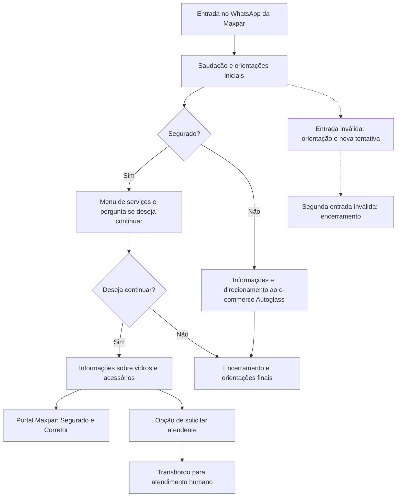
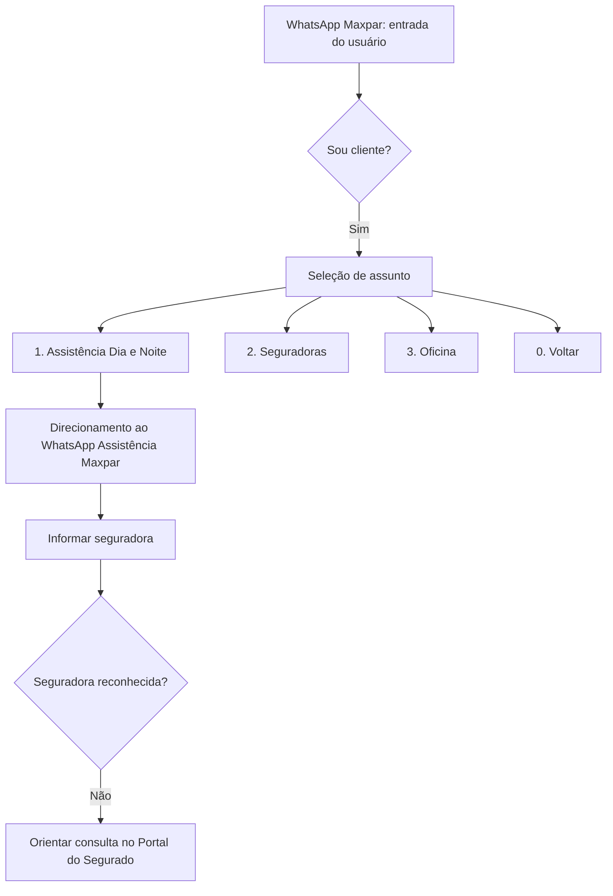

# Case de Análise de Negócios — WhatsApp Maxpar / Autoglass

**Tema:** transformação de canais digitais e automação parcial da jornada de atendimento relacionada a seguros auto, serviços ao segurado e direcionamento para canais da Autoglass.

**Link de acesso ao quadro original (compartilhamento liberado pela autora):** [Abrir Miro](https://miro.com/app/board/uXjVNlaxnuE=/?share_link_id=46998654048).

**Ferramenta de trabalho:** Miro. **Fonte original:** [quadro completo Maxpar/Autoglass](https://miro.com/app/board/uXjVNlaxnuE=/?share_link_id=46998654048).

> Este case documenta **o que está modelado no quadro**: Discovery, jornada de WhatsApp, histórias/regras, estudo de backlog, canvas MVP e POCs. A presença de um fluxo ou uma POC **não comprova implantação em produção**. O quadro original, com os links, imagens, telas, setas e posicionamento dos elementos, permanece intacto no Miro.

## 1. Contexto e objetivo de negócio

O material analisa a experiência de atendimento digital a **segurados/beneficiários e não segurados**, partindo do WhatsApp identificado no fluxo como **Maxpar Serviços**. O desenho mostra pontos de direcionamento ao portal do segurado, à assistência e a um atendente humano. Para quem não é segurado, aparecem orientações relacionadas ao **e-commerce de peças automotivas da Autoglass**.

A oportunidade de melhoria é tornar a jornada de atendimento mais clara: apresentar escolhas compreensíveis, orientar o cliente sobre o canal correto, reduzir interações sem direcionamento e definir o tratamento de entradas inválidas e o encaminhamento ao atendimento humano.

O estudo também inclui um **MVP** e caminhos considerados para futuros refinamentos de backlog. A análise é de canais digitais e jornada do usuário, não de subscrição de apólices.

## 2. Materiais efetivamente presentes no Miro

| Seção original | Material | Abrir |
| --- | --- | --- |
| Discovery - Canal do segurado/beneficiário | Prints e anotações sobre canais, comunicação e oportunidades de melhoria | [Discovery](https://miro.com/app/board/uXjVNlaxnuE=/?share_link_id=46998654048&moveToWidget=3458764581172626138) |
| Canvas MVP | Quadro com quatro imagens de referência | [Canvas MVP](https://miro.com/app/board/uXjVNlaxnuE=/?share_link_id=46998654048&moveToWidget=3458764581793445322) |
| Jornada 1-Menu atendimento ao seguurado e não segurado | Fluxograma da jornada, seus caminhos, decisões e mensagens | [Jornada 1](https://miro.com/app/board/uXjVNlaxnuE=/?share_link_id=46998654048&moveToWidget=3458764581758623044) |
| História do usuário | 10 cenários detalhados, mensagens e regras de negócio | [Histórias de usuário](https://miro.com/app/board/uXjVNlaxnuE=/?share_link_id=46998654048&moveToWidget=3458764581797052471) |
| Estudo dos próximos backlogs - Fluxograma (MVP) | Fluxo de estudo de atendimento, assistência, seguradoras e oficinas | [Estudo de backlog](https://miro.com/app/board/uXjVNlaxnuE=/?share_link_id=46998654048&moveToWidget=3458764581755947826) |
| POC 01- do MVP | Demonstração em vídeo vinculada ao quadro | [POC 01](https://miro.com/app/board/uXjVNlaxnuE=/?share_link_id=46998654048&moveToWidget=3458764582022045353) |
| POC 02 - MVP | Sequência de telas e imagens de POC | [POC 02](https://miro.com/app/board/uXjVNlaxnuE=/?share_link_id=46998654048&moveToWidget=3458764582024733080) |

**Vídeo da POC 01:** https://youtu.be/u4LxF7WXEUY

## 3. Discovery: observações e oportunidades

### Canais mapeados e finalidade

| Canal | Função apresentada no quadro | Aspecto funcional para melhoria |
| --- | --- | --- |
| **WhatsApp Maxpar** | Entrada, saudação, menu por perfil e orientações aos usuários | Tratamento de respostas inválidas, direcionamento e opção de atendimento humano |
| **Portal do Segurado Maxpar** | Canal de abertura/consulta de atendimento por seguradora, via **Segurado & Corretor** | Orientação clara para encontrar a seguradora e o serviço |
| **E-commerce Autoglass** | Canal de compra de peças automotivas indicado aos não segurados e no encerramento | Direcionamento para o destino correto |
| **Pontos de apoio** | Assistência Maxpar, atendimento humano e apresentação de canais via Linktree | Horários, rotas alternativas e informação acessível |

**Separação entre os estados do projeto:** o Discovery documenta observações do atendimento; a Jornada 1 modela as interações descritas; o estudo de backlog apresenta alternativas de evolução; as POCs demonstram possibilidades. Não foram atribuídas a essas propostas métricas ou status de implantação que o quadro não comprova.

Na área de Discovery constam observações relacionadas a:
- canais de contato via WhatsApp, portal e e-commerce;
- dificuldade de direcionamento e interações que não obtiveram resposta;
- necessidade de informar horário de atendimento e de orientar usuários fora desse período;
- possibilidade de direcionamento ao atendimento humano para orientações ao segurado ou beneficiário;
- unificação ou melhor apresentação de canais e eventual pesquisa de satisfação.

Esses itens são **achados/hipóteses anotados durante a descoberta**. Não há, no quadro consultado, uma medição validada de ganho de produtividade, NPS ou redução percentual do tempo de atendimento que possa ser atribuída à implementação.

## 4. Jornada modelada: WhatsApp segurado e não segurado

**[Fluxo completo exportado para o GitHub — 43 etapas e 36 ligações](./FLUXO_MIRO_JORNADA_COMPLETA.md)**. Esse material reproduz a topologia e transcreve os textos de cada etapa registrada no Miro.

A [Jornada 1 no Miro](https://miro.com/app/board/uXjVNlaxnuE=/?share_link_id=46998654048&moveToWidget=3458764581758623044) registra a saudação do WhatsApp da Maxpar, a distinção entre segurado e não segurado e o tratamento de opções válidas e inválidas.

### Ramificação de segurado

- Saudação e aviso de que **áudios, imagens e emojis não são compreendidos**, no cenário documentado.
- Menu inicial com opção **"Sou segurado"**.
- Apresentação de assuntos como abertura/status de atendimento para sinistro, guincho, carro reserva, motorista amigo e oficina.
- Pergunta se o usuário deseja continuar.
- Quando continua, informação de que o atendimento é exclusivo para **vidros e acessórios**, conforme cobertura contratada; orientação para acessar o site da Maxpar, selecionar **Segurado & Corretor** e escolher a seguradora.
- Para outros tipos de assistência, indicação dos canais/telefones exibidos no site.
- Alternativa de digitar **"Atendente"**, com transferência para a central de atendimento.

### Ramificação de não segurado / Autoglass

- Menu inicial com opção **"Não sou segurado"**.
- Orientação para compra de peças automotivas no **e-commerce da Autoglass**, conforme o fluxo.
- Na jornada de saída, o quadro também apresenta mensagem de encerramento com convite para conhecer o e-commerce.

### Erros de entrada

A documentação detalhada registra:
- uma primeira resposta de não entendimento e pedido para digitar a opção numérica corretamente;
- uma segunda ocorrência inválida seguida de mensagem de orientação e encerramento;
- regra indicando **até duas tentativas** para selecionar ou digitar novamente uma opção;
- início da conversa mediante entrada de qualquer informação do usuário.

A transcrição completa dos 10 cenários está em [CENARIOS_E_REGRAS_ORIGINAIS.md](./CENARIOS_E_REGRAS_ORIGINAIS.md).

### Visão executiva, sem substituir o fluxo do Miro

*Esta é uma **síntese interpretativa** da jornada mapeada, sem reescrever as transições, mensagens ou regras originais. O fluxograma detalhado, incluindo caminhos alternativos, continua no Miro.*

## 5. Estudo dos próximos backlogs — MVP

**[Fluxo completo exportado para o GitHub — 34 etapas e 24 ligações](./FLUXO_MIRO_BACKLOG_COMPLETO.md)**. Os rótulos foram abreviados apenas no diagrama, mas o texto completo de cada item é reproduzido na seção de rastreabilidade.

A área [Estudo dos próximos backlogs](https://miro.com/app/board/uXjVNlaxnuE=/?share_link_id=46998654048&moveToWidget=3458764581755947826) propõe um menu para o usuário identificado como cliente:

1. **Assistência Dia e Noite** (guincho, carro reserva, motorista amigo);
2. **Seguradoras**;
3. **Oficina**;
4. **0 para voltar**.

O material detalha especialmente a ramificação de **Assistência Dia e Noite**, com orientação de acesso ao WhatsApp de assistência Maxpar. Nessa segunda interação, o assistente solicita o nome da seguradora; o desenho registra um cenário em que a seguradora não é reconhecida e o usuário é orientado a procurar o **Portal do Segurado**.

Não foi presumido o desenho detalhado das opções "Seguradoras" e "Oficina" além do que a própria área do quadro apresenta.

### Visão resumida do estudo de backlog

*Diagrama de navegação criado apenas para leitura rápida; **não** substitui o estudo original, que pode conter outros passos e alternativas.*

## 6. História de usuário e critérios de aceitação

O Miro contém cenários de comportamento estruturados em **Dado / Quando / Então**, cobrindo:

- **Cenário 1:** saudação e primeira interação;
- **Cenários 2 e 3:** entradas inválidas na saudação (primeira e segunda ocorrência);
- **Cenário 4:** escolha do tipo de atendimento;
- **Cenários 5 e 6:** entradas inválidas na escolha do atendimento;
- **Cenário 7:** continuação da jornada e orientação sobre vidros e acessórios;
- **Cenários 8 e 9:** entradas inválidas no contexto de atendente;
- **Cenário 10:** solicitação de atendente e transferência para a central.

**Evidência:** [transcrição fiel dos 10 cenários e regras originais](./CENARIOS_E_REGRAS_ORIGINAIS.md).

### Pontos de alinhamento entre os artefatos (sem alterar nenhum deles)

O menu do desenho da **Jornada 1** usa **"Sou segurado / Não sou segurado"**, enquanto o texto da **História do usuário** e a área de **estudo de backlog** apresentam **"Sou cliente / Não sou cliente"**. São expressões diferentes que constam nas fontes. Mantivemos ambas e registramos a diferença para conferência funcional antes de uma implementação.

Da mesma forma, a área de estudo de backlog representa uma evolução de opções em relação à jornada documentada; não foi tratada como uma funcionalidade comprovadamente implantada.

## 7. POCs, telas e vídeo — evidências

- [Canvas MVP — quatro imagens originais](https://miro.com/app/board/uXjVNlaxnuE=/?share_link_id=46998654048&moveToWidget=3458764581793445322): informações visuais existentes no quadro, preservadas no local de origem.
- [POC 01 — Miro](https://miro.com/app/board/uXjVNlaxnuE=/?share_link_id=46998654048&moveToWidget=3458764582022045353), com **vídeo demonstrativo:** https://youtu.be/u4LxF7WXEUY.
- [POC 02 — Miro](https://miro.com/app/board/uXjVNlaxnuE=/?share_link_id=46998654048&moveToWidget=3458764582024733080): sequência de imagens do teste/experiência.
- [Mapeamento AS IS já existente no GitHub](../Mapeamento%20As%20is_detalhe.png): imagem original do repositório, não alterada.

Como as imagens e conexões são artefatos do quadro, os **links diretos do Miro** são a referência visual exata. O repositório não afirma que esses anexos foram reproduzidos como arquivos de imagem independentes.

## 8. Contribuições profissionais demonstradas

- **Business Analysis / Discovery:** investigação da jornada e dos pontos de contato com os usuários.
- **Mapeamento e transformação de processos:** representação visual de interações, decisões, exceções e transbordo ao humano.
- **Product Discovery / MVP:** organização do escopo em jornadas e análise de alternativas de evolução.
- **Gestão de requisitos:** definição de regras de negócio, critérios de aceite e cenários BDD.
- **Backlog:** documentação de opções e estudos para futuras entregas do canal digital.
- **Stakeholder Management:** criação de artefatos compartilháveis para alinhamento entre negócio, UX, atendimento e tecnologia.

Essas competências traduzem as entregas do case sem acrescentar métricas, datas de implantação ou resultados não demonstrados.

## 9. Rastreamento da documentação

| Fonte | Papel na documentação |
| --- | --- |
| [Miro original](https://miro.com/app/board/uXjVNlaxnuE=/?share_link_id=46998654048) | Fluxos, setas, imagens e conteúdos oficiais do quadro |
| [Jornada completa](./FLUXO_MIRO_JORNADA_COMPLETA.md) | 43 etapas e 36 conexões extraídas do fluxo do Miro |
| [Backlog completo](./FLUXO_MIRO_BACKLOG_COMPLETO.md) | 34 etapas e 24 conexões extraídas do fluxo do Miro |
| [Cenários e regras](./CENARIOS_E_REGRAS_ORIGINAIS.md) | Conteúdo textual registrado no Miro, sem mudança de lógica |
| [README anterior](../DOCUMENTACAO_ORIGINAL.md) | Histórico da apresentação original do case |
| [PNG do mapeamento original](../Mapeamento%20As%20is_detalhe.png) | Evidência visual já publicada no GitHub |

### Limites do case

Este repositório apresenta uma **documentação de portfólio**, não um sistema implantado. Não foram inseridos indicadores fictícios de conversão, satisfação, economia, NPS ou produtividade. O board do Miro permanece como fonte visual definitiva para a disposição dos itens, detalhes de interface e evidências visuais, enquanto a topologia e as mensagens das duas áreas de fluxograma também estão documentadas no GitHub.
