# Estudo do backlog — Fluxograma MVP

**Fonte do processo:** [Abrir a seção original no Miro](https://miro.com/app/board/uXjVNlaxnuE=/?moveToWidget=3458764581755947826).

Esta transcrição gráfica foi gerada **a partir dos IDs de etapas e ligações do fluxo original**, mantendo o sentido de cada ligação e os textos originais listados abaixo. Os rótulos do diagrama foram abreviados exclusivamente para legibilidade; **as mensagens completas não foram reescritas**. Para posição, formas, imagens e contexto, a referência definitiva é o Miro.

## Fluxograma completo — ligações de origem

```mermaid
flowchart TD
    N3458764581755990950["Inicio"]
    N3458764581755991353["Olá! 👋 Este é o WhatsApp oficial da Maxpar Serviços."]
    N3458764581756296462["Entrada do usuário"]
    N3458764581756376649["Para atendimento clica em uma das opções:"]
    N3458764581756376821["Menu numérico: 1. Sou cliente 2. Não sou cliente"]
    N3458764581756649414["1. Sou cliente"]
    N3458764581756649540["Sobre o que deseja falar hoje?"]
    N3458764581756703817["⚠️ Importante: ainda não entendemos áudio, imagens e emojis."]
    N3458764581756767946["1. Assistência Dia e Noite (guincho, carro reserva, motorista amigo) 2. Segurador..."]
    N3458764581756768750["1. Assistência Dia e Noite"]
    N3458764581756831614["Para abertura de Solicitação de Guincho, carro reserva, motorista amigo clique no..."]
    N3458764581756893709["Fim"]
    N3458764581756893791["2. Não"]
    N3458764581756960002["Etapa do Miro"]
    N3458764581756960591["1. Sim"]
    N3458764581756996970["A Maxpar Soluções agradece eu contato"]
    N3458764581757062942["Inicio"]
    N3458764581757063006["Transferência para Whatsapp Assistência Maxpar"]
    N3458764581757063143["Entrada do usuário"]
    N3458764581757063435["Etapa do Miro"]
    N3458764581757150504["Olá! Eu sou assistente virtual da Assistência 24 horas"]
    N3458764581757785840["Digite o primeiro nome da sua seguradora, em letra minúsculas e sem ascento, exem..."]
    N3458764581757841382["porto"]
    N3458764581757841573["Para abertura de atendimento clique no link abaixo: https://www.abraseuatendiment..."]
    N3458764581757841918["Desculpe, não conseguimos identificar essa seguradora em nosso sistema. 😞"]
    N3458764581757907028["Mas você também pode fazer essa consulta pelo Portal de segurado da Maxpar. Na pá..."]
    N3458764581757907159["Se preferir, acessa por aqui: ⬇️ Portal Maxpar Soluções https://www.maxpar.com/"]
    N3458764581757907216["Agradecemos por usar o WhatsApp para segurados da Maxpar Soluções. Precisando, é ..."]
    N3458764581757907375["Válido"]
    N3458764581758059272["Fim"]
    N3458764581758059290["Fim"]
    N3458764581758128463["Agradecemos por usar o WhatsApp para segurados da Maxpar Soluções. Precisando, é ..."]
    N3458764581760726903["Etapa do Miro"]
    N3458764581760789351["Etapa do Miro"]
    N3458764581756296462 -->|"Etapa do Miro"| N3458764581755991353
    N3458764581755990950 -->|"Etapa do Miro"| N3458764581756296462
    N3458764581756703817 -->|"Etapa do Miro"| N3458764581756376649
    N3458764581756376821 -->|"Etapa do Miro"| N3458764581756649414
    N3458764581756649414 -->|"Etapa do Miro"| N3458764581756649540
    N3458764581756767946 -->|"Etapa do Miro"| N3458764581756768750
    N3458764581756768750 -->|"Etapa do Miro"| N3458764581756831614
    N3458764581756893791 -->|"Etapa do Miro"| N3458764581756996970
    N3458764581756831614 -->|"Etapa do Miro"| N3458764581756960002
    N3458764581756960002 -->|"Etapa do Miro"| N3458764581756893791
    N3458764581756960002 -->|"Etapa do Miro"| N3458764581756960591
    N3458764581756996970 -->|"Etapa do Miro"| N3458764581756893709
    N3458764581756960591 -->|"Etapa do Miro"| N3458764581756649540
    N3458764581757062942 -->|"Etapa do Miro"| N3458764581757063006
    N3458764581757063435 -->|"Etapa do Miro"| N3458764581757063006
    N3458764581757063006 -->|"Etapa do Miro"| N3458764581757063143
    N3458764581757063143 -->|"Etapa do Miro"| N3458764581757150504
    N3458764581757785840 -->|"Etapa do Miro"| N3458764581757841382
    N3458764581757841382 -->|"Etapa do Miro"| N3458764581757907375
    N3458764581757907375 -->|"Etapa do Miro"| N3458764581757907028
    N3458764581757907375 -->|"Etapa do Miro"| N3458764581757841573
    N3458764581757907216 -->|"Etapa do Miro"| N3458764581758059290
    N3458764581758128463 -->|"Etapa do Miro"| N3458764581758059272
    N3458764581757841573 -->|"Etapa do Miro"| N3458764581758128463
```



## Conteúdo textual original das etapas

### 1. 3458764581755990950

[Localizar no Miro](https://miro.com/app/board/uXjVNlaxnuE=/?moveToWidget=3458764581755990950)

```text
Inicio
```

### 2. 3458764581755991353

[Localizar no Miro](https://miro.com/app/board/uXjVNlaxnuE=/?moveToWidget=3458764581755991353)

```text
Olá! 👋
Este é o WhatsApp oficial da Maxpar Serviços.
```

### 3. 3458764581756296462

[Localizar no Miro](https://miro.com/app/board/uXjVNlaxnuE=/?moveToWidget=3458764581756296462)

```text
Entrada do usuário
```

### 4. 3458764581756376649

[Localizar no Miro](https://miro.com/app/board/uXjVNlaxnuE=/?moveToWidget=3458764581756376649)

```text
Para atendimento clica em uma das opções:
```

### 5. 3458764581756376821

[Localizar no Miro](https://miro.com/app/board/uXjVNlaxnuE=/?moveToWidget=3458764581756376821)

```text
Menu numérico:

1. Sou cliente
2. Não sou cliente
```

### 6. 3458764581756649414

[Localizar no Miro](https://miro.com/app/board/uXjVNlaxnuE=/?moveToWidget=3458764581756649414)

```text
1. Sou cliente
```

### 7. 3458764581756649540

[Localizar no Miro](https://miro.com/app/board/uXjVNlaxnuE=/?moveToWidget=3458764581756649540)

```text
Sobre o que deseja falar hoje?
```

### 8. 3458764581756703817

[Localizar no Miro](https://miro.com/app/board/uXjVNlaxnuE=/?moveToWidget=3458764581756703817)

```text
⚠️ Importante: ainda não entendemos
áudio, imagens e emojis.
```

### 9. 3458764581756767946

[Localizar no Miro](https://miro.com/app/board/uXjVNlaxnuE=/?moveToWidget=3458764581756767946)

```text
1. Assistência Dia e Noite (guincho, carro reserva, motorista amigo)
2. Seguradoras 
3. Oficina

Ou digite 0 para voltar
```

### 10. 3458764581756768750

[Localizar no Miro](https://miro.com/app/board/uXjVNlaxnuE=/?moveToWidget=3458764581756768750)

```text
1. Assistência Dia e Noite
```

### 11. 3458764581756831614

[Localizar no Miro](https://miro.com/app/board/uXjVNlaxnuE=/?moveToWidget=3458764581756831614)

```text
Para abertura de Solicitação de Guincho, carro reserva, motorista amigo clique no link abaixo e depois clique em 'Enviar':

https://wa.me/551121215555?text=OLA

Posso ajudar em algo mais?
1. Sim
2. Não
```

### 12. 3458764581756893709

[Localizar no Miro](https://miro.com/app/board/uXjVNlaxnuE=/?moveToWidget=3458764581756893709)

```text
Fim
```

### 13. 3458764581756893791

[Localizar no Miro](https://miro.com/app/board/uXjVNlaxnuE=/?moveToWidget=3458764581756893791)

```text
2. Não
```

### 14. 3458764581756960002

[Localizar no Miro](https://miro.com/app/board/uXjVNlaxnuE=/?moveToWidget=3458764581756960002)

```text

```

### 15. 3458764581756960591

[Localizar no Miro](https://miro.com/app/board/uXjVNlaxnuE=/?moveToWidget=3458764581756960591)

```text
1. Sim
```

### 16. 3458764581756996970

[Localizar no Miro](https://miro.com/app/board/uXjVNlaxnuE=/?moveToWidget=3458764581756996970)

```text
A Maxpar Soluções agradece eu contato
```

### 17. 3458764581757062942

[Localizar no Miro](https://miro.com/app/board/uXjVNlaxnuE=/?moveToWidget=3458764581757062942)

```text
Inicio
```

### 18. 3458764581757063006

[Localizar no Miro](https://miro.com/app/board/uXjVNlaxnuE=/?moveToWidget=3458764581757063006)

```text
Transferência para Whatsapp Assistência Maxpar
```

### 19. 3458764581757063143

[Localizar no Miro](https://miro.com/app/board/uXjVNlaxnuE=/?moveToWidget=3458764581757063143)

```text
Entrada do usuário
```

### 20. 3458764581757063435

[Localizar no Miro](https://miro.com/app/board/uXjVNlaxnuE=/?moveToWidget=3458764581757063435)

```text

```

### 21. 3458764581757150504

[Localizar no Miro](https://miro.com/app/board/uXjVNlaxnuE=/?moveToWidget=3458764581757150504)

```text
Olá! Eu sou assistente virtual da Assistência 24 horas
```

### 22. 3458764581757785840

[Localizar no Miro](https://miro.com/app/board/uXjVNlaxnuE=/?moveToWidget=3458764581757785840)

```text
Digite o primeiro nome da sua seguradora, em letra minúsculas e sem ascento, exemplo 'porto', 'liberty'.

Vamos lá, pode digitar:
```

### 23. 3458764581757841382

[Localizar no Miro](https://miro.com/app/board/uXjVNlaxnuE=/?moveToWidget=3458764581757841382)

```text
porto
```

### 24. 3458764581757841573

[Localizar no Miro](https://miro.com/app/board/uXjVNlaxnuE=/?moveToWidget=3458764581757841573)

```text
Para abertura de atendimento clique no link abaixo:
https://www.abraseuatendimento.com.br/#/porto/menu-atendimento

Se preferir falar na Central de atendimento ligue:
333 76786 (Grande São Paulo), 4004-76786 (Capitais e Regiões Metropolitanas) ou 0300 337 6786 (demais localidades).
```

### 25. 3458764581757841918

[Localizar no Miro](https://miro.com/app/board/uXjVNlaxnuE=/?moveToWidget=3458764581757841918)

```text
Desculpe, não conseguimos identificar essa seguradora em nosso sistema. 😞
```

### 26. 3458764581757907028

[Localizar no Miro](https://miro.com/app/board/uXjVNlaxnuE=/?moveToWidget=3458764581757907028)

```text
Mas você também pode fazer essa consulta pelo Portal de segurado da Maxpar. Na página inicial, clica no card Segurado & Corretor e busca pelo nome do proponente.
```

### 27. 3458764581757907159

[Localizar no Miro](https://miro.com/app/board/uXjVNlaxnuE=/?moveToWidget=3458764581757907159)

```text
Se preferir, acessa por aqui: ⬇️
Portal Maxpar Soluções
https://www.maxpar.com/
```

### 28. 3458764581757907216

[Localizar no Miro](https://miro.com/app/board/uXjVNlaxnuE=/?moveToWidget=3458764581757907216)

```text
Agradecemos por usar o WhatsApp para segurados da Maxpar Soluções. Precisando, é só chamar. 👋
```

### 29. 3458764581757907375

[Localizar no Miro](https://miro.com/app/board/uXjVNlaxnuE=/?moveToWidget=3458764581757907375)

```text
Válido
```

### 30. 3458764581758059272

[Localizar no Miro](https://miro.com/app/board/uXjVNlaxnuE=/?moveToWidget=3458764581758059272)

```text
Fim
```

### 31. 3458764581758059290

[Localizar no Miro](https://miro.com/app/board/uXjVNlaxnuE=/?moveToWidget=3458764581758059290)

```text
Fim
```

### 32. 3458764581758128463

[Localizar no Miro](https://miro.com/app/board/uXjVNlaxnuE=/?moveToWidget=3458764581758128463)

```text
Agradecemos por usar o WhatsApp para segurados da Maxpar Soluções. Precisando, é só chamar. 👋
```

### 33. 3458764581760726903

[Localizar no Miro](https://miro.com/app/board/uXjVNlaxnuE=/?moveToWidget=3458764581760726903)

```text

```

### 34. 3458764581760789351

[Localizar no Miro](https://miro.com/app/board/uXjVNlaxnuE=/?moveToWidget=3458764581760789351)

```text

```

## Verificação de rastreabilidade

- Etapas originais representadas: **34**.
- Ligações originais representadas: **24**.
- Fonte: **quadro Miro original**, sem alterações na modelagem.
- Este diagrama foi extraído da topologia e das mensagens dos objetos, não é um novo desenho de processo. A imagem/formatação exata continua no Miro.
