# Jornada 1 — Atendimento a segurado e não segurado

**Fonte do processo:** [Abrir a seção original no Miro](https://miro.com/app/board/uXjVNlaxnuE=/?share_link_id=46998654048&moveToWidget=3458764581758623044).

Esta transcrição gráfica foi gerada **a partir dos IDs de etapas e ligações do fluxo original**, mantendo o sentido de cada ligação e os textos originais listados abaixo. Os rótulos do diagrama foram abreviados exclusivamente para legibilidade; **as mensagens completas não foram reescritas**. Para posição, formas, imagens e contexto, a referência definitiva é o Miro.

## Fluxograma completo — ligações de origem

```mermaid
flowchart TD
    N3458764581787934934["Inicio"]
    N3458764581787934935["Olá! 👋 Este é o WhatsApp oficial da Maxpar Serviços."]
    N3458764581787934936["Entrada do usuário"]
    N3458764581787934939["Para atendimento clica em uma das opções:"]
    N3458764581787934940["Menu numérico: 1. Sou segurado 2. Não sou segurado"]
    N3458764581787934941["Entrada do usuário"]
    N3458764581787934945["⚠️ Importante: ainda não entendemos áudio, imagens e emojis."]
    N3458764581787934947["Tenha em mãos o nome da seguradora. Agora acesse o link abaixo: https://www.maxpa..."]
    N3458764581789065188["Opção Válida"]
    N3458764581790145453["Por aqui podemos ajudar com Abertura e Status de atendimento para sinistro, guinc..."]
    N3458764581790298849["1. Sim"]
    N3458764581791661922["Se precisar de mais alguma coisa, é só me chamar."]
    N3458764581791814863["Aqui o atendimento é exclusivo para vidros e acessórios de acordo com a contrataç..."]
    N3458764581793931930["1. Sou segurado"]
    N3458764581793983522["Hum, não entendi. Preciso que digite a opçao 'número' para continuar"]
    N3458764581794097207["Tentativa 1x"]
    N3458764581794171804["Ainda não entendi, me desculpe."]
    N3458764581794245395["Se tiver outras perguntas, estou aqui pra te ajudar."]
    N3458764581795307601["FIM"]
    N3458764581798432156["Estamos transferindo para um de nossos consultores, por favor aguarde."]
    N3458764581798518579["Opção Válida"]
    N3458764581798607689["Entrada do usuário"]
    N3458764581798672087["TRANSBORDO PARA ATENDENTE"]
    N3458764581798818393["Hum, não entendi. Preciso que digite a opçao 'número' para continuar"]
    N3458764581798818398["Ainda não entendi, me desculpe."]
    N3458764581798818400["Se tiver outras perguntas, estou aqui pra te ajudar."]
    N3458764581798818401["FIM"]
    N3458764581799105062["Atendente"]
    N3458764581799759721["Hum, não entendi. Preciso que digite a opçao 'número' para continuar"]
    N3458764581799759723["Tentativa 1x"]
    N3458764581799759726["Ainda não entendi, me desculpe."]
    N3458764581799759728["Se tiver outras perguntas, estou aqui pra te ajudar."]
    N3458764581799759729["FIM"]
    N3458764581799835967["Opção Válida"]
    N3458764581799912314["Entrada do usuário"]
    N3458764581813678208["1. Não sou segurado"]
    N3458764581813678858["Neste canal podemos ajudar com os seguintes assuntos: Compra de peças automotivas..."]
    N3458764581813967742["Caso seja corretor parceiro acesse o canal de corretores da Maxpar através do lin..."]
    N3458764581817276730["Se precisar de mais alguma coisa, é só me chamar."]
    N3458764581817345930["Fim"]
    N3458764581817500430["1. Não"]
    N3458764581817591114["Você selecionou que 'Não' quer continuar, mas se precisar de alguma coisa, é só m..."]
    N3458764581817766012["Fim"]
    N3458764581787934936 -->|"Etapa do Miro"| N3458764581787934935
    N3458764581787934934 -->|"Etapa do Miro"| N3458764581787934936
    N3458764581787934940 -->|"Etapa do Miro"| N3458764581787934941
    N3458764581787934945 -->|"Etapa do Miro"| N3458764581787934939
    N3458764581787934941 -->|"Etapa do Miro"| N3458764581789065188
    N3458764581790145453 -->|"Etapa do Miro"| N3458764581799912314
    N3458764581790298849 -->|"Etapa do Miro"| N3458764581791814863
    N3458764581789065188 -->|"Etapa do Miro"| N3458764581793931930
    N3458764581793931930 -->|"Etapa do Miro"| N3458764581790145453
    N3458764581789065188 -->|"Etapa do Miro"| N3458764581794097207
    N3458764581793983522 -->|"Etapa do Miro"| N3458764581787934941
    N3458764581794097207 -->|"Etapa do Miro"| N3458764581793983522
    N3458764581794097207 -->|"Etapa do Miro"| N3458764581794171804
    N3458764581794245395 -->|"Etapa do Miro"| N3458764581795307601
    N3458764581798518579 -->|"Etapa do Miro"| N3458764581799105062
    N3458764581791661922 -->|"Etapa do Miro"| N3458764581798607689
    N3458764581798607689 -->|"Etapa do Miro"| N3458764581798518579
    N3458764581798432156 -->|"Etapa do Miro"| N3458764581798672087
    N3458764581798818400 -->|"Etapa do Miro"| N3458764581798818401
    N3458764581798818393 -->|"Etapa do Miro"| N3458764581798607689
    N3458764581799105062 -->|"Etapa do Miro"| N3458764581798432156
    N3458764581799759721 -->|"Etapa do Miro"| N3458764581799912314
    N3458764581799835967 -->|"Etapa do Miro"| N3458764581799759723
    N3458764581799759723 -->|"Etapa do Miro"| N3458764581799759721
    N3458764581799759723 -->|"Etapa do Miro"| N3458764581799759726
    N3458764581799759728 -->|"Etapa do Miro"| N3458764581799759729
    N3458764581799835967 -->|"Etapa do Miro"| N3458764581790298849
    N3458764581799912314 -->|"Etapa do Miro"| N3458764581799835967
    N3458764581798518579 -->|"Etapa do Miro"| N3458764581798818393
    N3458764581798518579 -->|"Etapa do Miro"| N3458764581798818398
    N3458764581789065188 -->|"Etapa do Miro"| N3458764581813678208
    N3458764581813678208 -->|"Etapa do Miro"| N3458764581813678858
    N3458764581817276730 -->|"Etapa do Miro"| N3458764581817345930
    N3458764581799835967 -->|"Etapa do Miro"| N3458764581817500430
    N3458764581817500430 -->|"Etapa do Miro"| N3458764581817591114
    N3458764581817591114 -->|"Etapa do Miro"| N3458764581817766012
```



## Conteúdo textual original das etapas

### 1. 3458764581787934934

[Localizar no Miro](https://miro.com/app/board/uXjVNlaxnuE=/?share_link_id=46998654048&moveToWidget=3458764581787934934)

```text
Inicio
```

### 2. 3458764581787934935

[Localizar no Miro](https://miro.com/app/board/uXjVNlaxnuE=/?share_link_id=46998654048&moveToWidget=3458764581787934935)

```text
Olá! 👋
Este é o WhatsApp oficial da Maxpar Serviços.
```

### 3. 3458764581787934936

[Localizar no Miro](https://miro.com/app/board/uXjVNlaxnuE=/?share_link_id=46998654048&moveToWidget=3458764581787934936)

```text
Entrada do usuário
```

### 4. 3458764581787934939

[Localizar no Miro](https://miro.com/app/board/uXjVNlaxnuE=/?share_link_id=46998654048&moveToWidget=3458764581787934939)

```text
Para atendimento clica em uma das opções:
```

### 5. 3458764581787934940

[Localizar no Miro](https://miro.com/app/board/uXjVNlaxnuE=/?share_link_id=46998654048&moveToWidget=3458764581787934940)

```text
Menu numérico:

1. Sou segurado
2. Não sou segurado
```

### 6. 3458764581787934941

[Localizar no Miro](https://miro.com/app/board/uXjVNlaxnuE=/?share_link_id=46998654048&moveToWidget=3458764581787934941)

```text
Entrada do usuário
```

### 7. 3458764581787934945

[Localizar no Miro](https://miro.com/app/board/uXjVNlaxnuE=/?share_link_id=46998654048&moveToWidget=3458764581787934945)

```text
⚠️ Importante: ainda não entendemos
áudio, imagens e emojis.
```

### 8. 3458764581787934947

[Localizar no Miro](https://miro.com/app/board/uXjVNlaxnuE=/?share_link_id=46998654048&moveToWidget=3458764581787934947)

```text
Tenha em mãos o nome da seguradora.

Agora acesse o link abaixo:
https://www.maxpar.com/

Em seguida clique no card 'Segurado&Corretor' e escolha a seguradora.
Nesta opção é possível abrir um novo atendimento na seguradora ou consultar status.

Para solicitação de guincho, carro reserva, motorista amigo ligue no 0800 disponível no site, card da seguradora, ou clique em 'iniciar atendimento', para visualizar o número.

Você também pode digitar 'Atendente' para fala com um de nossos consultores
```

### 9. 3458764581789065188

[Localizar no Miro](https://miro.com/app/board/uXjVNlaxnuE=/?share_link_id=46998654048&moveToWidget=3458764581789065188)

```text
Opção Válida
```

### 10. 3458764581790145453

[Localizar no Miro](https://miro.com/app/board/uXjVNlaxnuE=/?share_link_id=46998654048&moveToWidget=3458764581790145453)

```text
Por aqui podemos ajudar com Abertura e Status de atendimento para sinistro, guincho, carro reserva, motorista amigo e oficina

Deseja continuar?

1. Sim
2. Não
```

### 11. 3458764581790298849

[Localizar no Miro](https://miro.com/app/board/uXjVNlaxnuE=/?share_link_id=46998654048&moveToWidget=3458764581790298849)

```text
1. Sim
```

### 12. 3458764581791661922

[Localizar no Miro](https://miro.com/app/board/uXjVNlaxnuE=/?share_link_id=46998654048&moveToWidget=3458764581791661922)

```text
Se precisar de mais alguma coisa, é só me chamar.
```

### 13. 3458764581791814863

[Localizar no Miro](https://miro.com/app/board/uXjVNlaxnuE=/?share_link_id=46998654048&moveToWidget=3458764581791814863)

```text
Aqui o atendimento é exclusivo para vidros e acessórios de acordo com a contratação da sua apólice.
```

### 14. 3458764581793931930

[Localizar no Miro](https://miro.com/app/board/uXjVNlaxnuE=/?share_link_id=46998654048&moveToWidget=3458764581793931930)

```text
1. Sou segurado
```

### 15. 3458764581793983522

[Localizar no Miro](https://miro.com/app/board/uXjVNlaxnuE=/?share_link_id=46998654048&moveToWidget=3458764581793983522)

```text
Hum, não entendi. Preciso que digite a opçao 'número' para continuar
```

### 16. 3458764581794097207

[Localizar no Miro](https://miro.com/app/board/uXjVNlaxnuE=/?share_link_id=46998654048&moveToWidget=3458764581794097207)

```text
Tentativa 1x
```

### 17. 3458764581794171804

[Localizar no Miro](https://miro.com/app/board/uXjVNlaxnuE=/?share_link_id=46998654048&moveToWidget=3458764581794171804)

```text
Ainda não entendi, me desculpe.
```

### 18. 3458764581794245395

[Localizar no Miro](https://miro.com/app/board/uXjVNlaxnuE=/?share_link_id=46998654048&moveToWidget=3458764581794245395)

```text
Se tiver outras perguntas, estou aqui pra te ajudar.
```

### 19. 3458764581795307601

[Localizar no Miro](https://miro.com/app/board/uXjVNlaxnuE=/?share_link_id=46998654048&moveToWidget=3458764581795307601)

```text
FIM
```

### 20. 3458764581798432156

[Localizar no Miro](https://miro.com/app/board/uXjVNlaxnuE=/?share_link_id=46998654048&moveToWidget=3458764581798432156)

```text
Estamos transferindo para um de nossos consultores, por favor aguarde.
```

### 21. 3458764581798518579

[Localizar no Miro](https://miro.com/app/board/uXjVNlaxnuE=/?share_link_id=46998654048&moveToWidget=3458764581798518579)

```text
Opção Válida
```

### 22. 3458764581798607689

[Localizar no Miro](https://miro.com/app/board/uXjVNlaxnuE=/?share_link_id=46998654048&moveToWidget=3458764581798607689)

```text
Entrada do usuário
```

### 23. 3458764581798672087

[Localizar no Miro](https://miro.com/app/board/uXjVNlaxnuE=/?share_link_id=46998654048&moveToWidget=3458764581798672087)

```text
TRANSBORDO PARA ATENDENTE
```

### 24. 3458764581798818393

[Localizar no Miro](https://miro.com/app/board/uXjVNlaxnuE=/?share_link_id=46998654048&moveToWidget=3458764581798818393)

```text
Hum, não entendi. Preciso que digite a opçao 'número' para continuar
```

### 25. 3458764581798818398

[Localizar no Miro](https://miro.com/app/board/uXjVNlaxnuE=/?share_link_id=46998654048&moveToWidget=3458764581798818398)

```text
Ainda não entendi, me desculpe.
```

### 26. 3458764581798818400

[Localizar no Miro](https://miro.com/app/board/uXjVNlaxnuE=/?share_link_id=46998654048&moveToWidget=3458764581798818400)

```text
Se tiver outras perguntas, estou aqui pra te ajudar.
```

### 27. 3458764581798818401

[Localizar no Miro](https://miro.com/app/board/uXjVNlaxnuE=/?share_link_id=46998654048&moveToWidget=3458764581798818401)

```text
FIM
```

### 28. 3458764581799105062

[Localizar no Miro](https://miro.com/app/board/uXjVNlaxnuE=/?share_link_id=46998654048&moveToWidget=3458764581799105062)

```text
Atendente
```

### 29. 3458764581799759721

[Localizar no Miro](https://miro.com/app/board/uXjVNlaxnuE=/?share_link_id=46998654048&moveToWidget=3458764581799759721)

```text
Hum, não entendi. Preciso que digite a opçao 'número' para continuar
```

### 30. 3458764581799759723

[Localizar no Miro](https://miro.com/app/board/uXjVNlaxnuE=/?share_link_id=46998654048&moveToWidget=3458764581799759723)

```text
Tentativa 1x
```

### 31. 3458764581799759726

[Localizar no Miro](https://miro.com/app/board/uXjVNlaxnuE=/?share_link_id=46998654048&moveToWidget=3458764581799759726)

```text
Ainda não entendi, me desculpe.
```

### 32. 3458764581799759728

[Localizar no Miro](https://miro.com/app/board/uXjVNlaxnuE=/?share_link_id=46998654048&moveToWidget=3458764581799759728)

```text
Se tiver outras perguntas, estou aqui pra te ajudar.
```

### 33. 3458764581799759729

[Localizar no Miro](https://miro.com/app/board/uXjVNlaxnuE=/?share_link_id=46998654048&moveToWidget=3458764581799759729)

```text
FIM
```

### 34. 3458764581799835967

[Localizar no Miro](https://miro.com/app/board/uXjVNlaxnuE=/?share_link_id=46998654048&moveToWidget=3458764581799835967)

```text
Opção Válida
```

### 35. 3458764581799912314

[Localizar no Miro](https://miro.com/app/board/uXjVNlaxnuE=/?share_link_id=46998654048&moveToWidget=3458764581799912314)

```text
Entrada do usuário
```

### 36. 3458764581813678208

[Localizar no Miro](https://miro.com/app/board/uXjVNlaxnuE=/?share_link_id=46998654048&moveToWidget=3458764581813678208)

```text
1. Não sou segurado
```

### 37. 3458764581813678858

[Localizar no Miro](https://miro.com/app/board/uXjVNlaxnuE=/?share_link_id=46998654048&moveToWidget=3458764581813678858)

```text
Neste canal podemos ajudar com os seguintes assuntos:

Compra de peças automotivas visite nosso e-commerce por meio do link:
https://www.autoglassonline.com.br/
```

### 38. 3458764581813967742

[Localizar no Miro](https://miro.com/app/board/uXjVNlaxnuE=/?share_link_id=46998654048&moveToWidget=3458764581813967742)

```text
Caso seja corretor parceiro acesse o canal de corretores da Maxpar através do link:

https://wa.me/55273320-4114?text=OLA
```

### 39. 3458764581817276730

[Localizar no Miro](https://miro.com/app/board/uXjVNlaxnuE=/?share_link_id=46998654048&moveToWidget=3458764581817276730)

```text
Se precisar de mais alguma coisa, é só me chamar.
```

### 40. 3458764581817345930

[Localizar no Miro](https://miro.com/app/board/uXjVNlaxnuE=/?share_link_id=46998654048&moveToWidget=3458764581817345930)

```text
Fim
```

### 41. 3458764581817500430

[Localizar no Miro](https://miro.com/app/board/uXjVNlaxnuE=/?share_link_id=46998654048&moveToWidget=3458764581817500430)

```text
1. Não
```

### 42. 3458764581817591114

[Localizar no Miro](https://miro.com/app/board/uXjVNlaxnuE=/?share_link_id=46998654048&moveToWidget=3458764581817591114)

```text
Você selecionou que "Não" quer continuar, mas se precisar de alguma coisa, é só me chamar.

Aproveite e conheça nosso e-commerce de peças automotivas, com instalação grátis, acesse o link:

https://www.autoglassonline.com.br/
```

### 43. 3458764581817766012

[Localizar no Miro](https://miro.com/app/board/uXjVNlaxnuE=/?share_link_id=46998654048&moveToWidget=3458764581817766012)

```text
Fim
```

## Verificação de rastreabilidade

- Etapas originais representadas: **43**.
- Ligações originais representadas: **36**.
- Fonte: **quadro Miro original**, sem alterações na modelagem.
- Este diagrama foi extraído da topologia e das mensagens dos objetos, não é um novo desenho de processo. A imagem/formatação exata continua no Miro.
